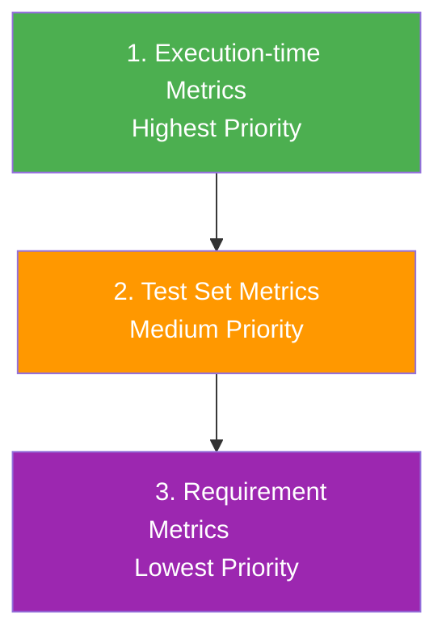

import { YouTubeEmbed } from "@/components/YouTubeEmbed";

# Test Execution

Executing a test set runs it against an endpoint to evaluate your LLM application. Each execution creates a [Test Run](/docs/test-runs) containing all individual test results with detailed metrics and evaluation data. This guide covers the configuration options available when running tests.

<YouTubeEmbed videoId="vdbWfqhQpZs" title="Test execution walkthrough" />

## Execution Overview

When you execute a test set, Rhesis:

1. Sends each test prompt to your configured endpoint
2. Captures the model's response
3. Evaluates responses against configured metrics
4. Records results in a test run for analysis

## Starting a Test Execution

To execute a test set:

1. Navigate to **Test Sets** in the sidebar
2. Select the test set you want to execute
3. Click the **Execute test set** (play) button
4. Choose an endpoint under **Run against**, and change any other section you need
5. Click **Execute Test Set** to start

<ThemeAwareImage
  lightSrc="/screenshots/rhesis-ai-test-set-execution.webp"
  darkSrc="/screenshots/rhesis-ai-test-set-execution-dark.webp"
  alt="Execute Test Set drawer with the What to run, Run against, Scoring, When and More options sections"
/>

The drawer has five sections. **Scoring** and **More options** start folded, unless settings were
carried over into them (a re-run, or a schedule with custom metrics). A folded section shows its
current settings on one line. The line next to the buttons says how many runs and tests
the click starts.

## What to run

The test set to execute. It is fixed when you start from a test set's page or select test sets in
the list. From **Test Runs › New Test Run**, pick the test set here.

## Run against

### Endpoint

Choose the [endpoint](/docs/endpoints) to test against. The list shows the endpoints of the active
project. Create endpoints in the **Endpoints** section before executing tests.

### Experiments

Add [experiments](/docs/experiments) to run the test set with their parameters pinned. Each selected
experiment version starts its own test run. Leave it empty to run without an experiment.

## Scoring

### Metrics Source

Metrics define how test responses are evaluated. Rhesis supports a flexible hierarchy that allows
you to configure metrics at different levels.

When executing a test set, you can choose from three metrics sources:

| Source | Description |
|--------|-------------|
| **Requirement Metrics** | Use default metrics defined on each test's requirement. This is the standard configuration. |
| **Test Set Metrics** | Use metrics configured on the test set. Overrides requirement-level defaults. |
| **Custom Metrics** | Define specific metrics for this execution only. Completely overrides other levels. |

Rhesis resolves which metrics to use based on a priority hierarchy. When a test execution starts, the system checks for metrics at each level in order, using the first level that has metrics configured.

The priority order ensures maximum flexibility: you can define sensible defaults at the requirement level, customize them for specific test sets, and still override everything for individual executions when needed.

<Callout type="warning">
  There is no merging between levels. If execution-time metrics are specified, they completely replace test set and requirement metrics.
</Callout>

#### Defining Custom Metrics

To use custom metrics for a single execution:

1. In the **Metrics Source** dropdown, select **Custom Metrics**
2. Click **Add metric** to open the metric selection dialog
3. Select the metrics you want to use
4. Only metrics applicable to your test set type (Single-Turn or Multi-Turn) are shown

<Callout type="info">
  Custom execution-time metrics are not saved to the test set. They only apply to the current test run.
</Callout>

#### When to Use Each Level

| Level | Use Case |
|-------|----------|
| **Requirement Metrics** | Standard testing with default evaluation criteria per requirement type |
| **Test Set Metrics** | Specialized test sets like Garak security tests with custom detectors |
| **Execution-time Metrics** | Quick experiments, A/B testing evaluation criteria, one-off validations |

### Evaluation Model

Select which model evaluates test responses using your configured [Metrics](/docs/metrics). This applies to both single-turn and multi-turn test sets.

- **Default model**: Uses the default evaluation model configured in your [Model settings](/docs/models). The currently configured model name is shown in the description.
- **Specific model**: Choose any model connected to your organization.

### Scoring Target

The scoring target controls whether the execution calls your endpoint or re-uses outputs from a previous run:

| Target | Description | Best For |
|--------|-------------|----------|
| **Fresh Outputs** | Calls the endpoint and scores the new responses. This is the default behavior. | Standard test runs, regression testing |
| **Reuse Outputs** | Re-scores outputs from the latest completed test run without calling the endpoint. Only metrics are re-evaluated. | Trying different metrics, metric tuning, cost-free re-evaluation |

When you select **Reuse Outputs**, Rhesis looks up the most recent completed test run for the selected test set and endpoint combination. An info panel shows the referenced run's name, date, pass rate, and test count, with a link to view the original run.

<Callout type="info">
  **Reuse Outputs** needs a completed test run of this test set on the selected endpoint, so it is offered when you start from the test set's page or re-run a test run. Otherwise, and for schedules, the option is disabled.
</Callout>

This is particularly useful when you want to:

- **Experiment with different metrics** without re-running expensive API calls
- **Compare evaluation criteria** by re-scoring the same outputs with different metric configurations
- **Validate metric changes** by checking how updated metrics affect existing results

## When

**Now** starts the run when you click the button. **Once, later** and **Repeat** turn the drawer
into a schedule; see [Scheduling Test Runs](/docs/test-runs/scheduling).

## More options

### Execution Mode

Choose how tests are processed:

| Mode | Description | Best For |
|------|-------------|----------|
| **Parallel** | Tests run simultaneously for faster execution | Large test sets, CI/CD pipelines |
| **Sequential** | Tests run one after another | Rate-limited APIs, debugging |

### Execution Model (Multi-Turn Only)

For multi-turn test sets, select the model that drives the [Penelope](/docs/tests/conversation-simulation) conversation agent. This option is visible when executing a multi-turn test set, or several test sets selected in the list.

- **Default model**: Uses the default execution model configured in your [Model settings](/docs/models).
- **Specific model**: Choose any model connected to your organization.

<Callout type="info">
  Model overrides apply only to the current run. They do not change your default model settings.
</Callout>

### Preflight Checks

**Run Preflight Checks** is on by default. Before execution, the run drawer validates the selected endpoint, models, test
sets, and metrics through `POST /preflight-checks`. Results stream back to the
drawer while checks run, so you can retry, continue, or adjust configuration
before starting the test run.

| Check | When it runs | What it validates |
| --- | --- | --- |
| Endpoint Connectivity | Fresh-output runs | The selected endpoint can be reached before live execution |
| Evaluation Model | All runs | An evaluation model is configured and usable |
| Execution Model | Multi-turn runs | A Penelope execution model is configured and usable |
| Test Set Has Tests | All runs | Each selected test set contains tests |
| Requirement-Metric Coverage | All runs | Tests have requirement and metric coverage for scoring |
| Metric Functionality | All runs | Selected metrics can run before the full execution starts |
| Metric-Endpoint Compatibility | All runs | Metrics that require `context`, `tool_calls`, or expected responses have the data they need from the endpoint mapping and tests |

<Callout type="info">
  Endpoint connectivity is skipped for **Reuse Outputs** runs because the endpoint
  is not called in that mode. Compatibility warnings do not block execution; update
  the endpoint response mapping, add expected responses, or choose compatible
  metrics before continuing.
</Callout>

### Test Run Tags

Add tags to organize and filter test runs:

- Type tag names and press Enter or comma to add
- Tags help categorize runs by purpose, sprint, or feature
- Filter test runs by tags in the Test Runs overview

## Re-running Tests

You can re-run a test from the test run detail view:

1. Navigate to **Test Runs** and select a test run
2. Click the **Re-run** button
3. The re-run drawer opens with the same sections:
   - The test set and endpoint are fixed
   - Metrics and experiments start from the original run; **Scoring** starts open
   - Models start from your current defaults, not the original run's
4. Click **Re-run Tests** to start a new execution

When re-running with **Reuse Outputs** selected as the scoring target, the outputs from the test run you are currently viewing are reused. This lets you quickly re-evaluate the same responses with different metrics or configurations.

<Callout type="default">
  Re-running creates a new test run with the same test set and endpoint. This is useful for regression testing, validating fixes, or re-scoring existing outputs with updated metrics.
</Callout>

## Next steps

- View and analyze results in [Test Runs](/docs/test-runs)
- Define evaluation criteria in [Metrics](/docs/metrics)
- Configure [Endpoints](/docs/endpoints) to run tests against
